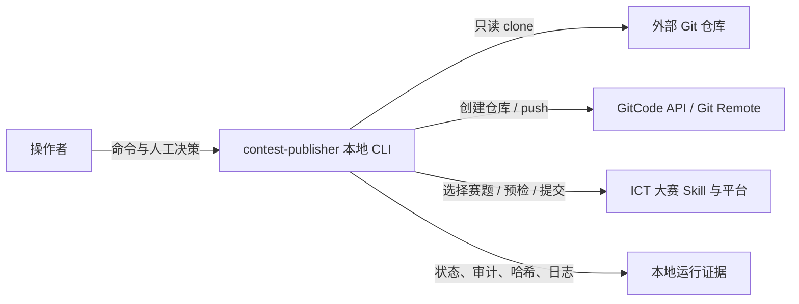
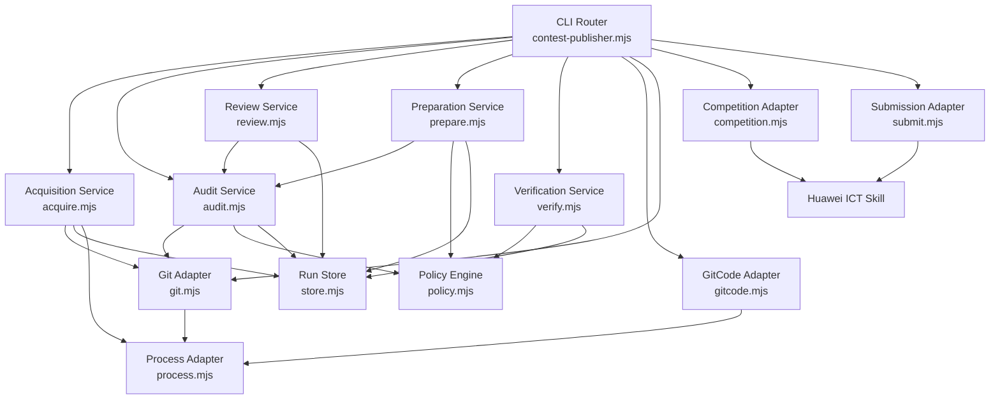
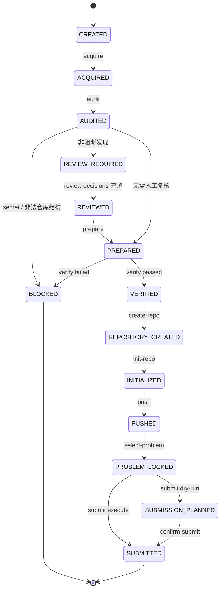

# contest-publisher 软件架构

> 版本：0.1
> 更新日期：2026-10-10
> 状态：已实现核心闭环，外部写操作默认 dry-run

## 1. 架构目标

`contest-publisher` 是一个本地 CLI 流程编排工具，负责将外部 Git 仓库转化为可审计、可验证、可提交的竞赛工作副本，并在通过门禁后调用既有 ICT 大赛 Skill 完成作品提交。

系统的核心目标不是简单复制仓库，而是建立一个**可追溯的代码提取与提交流水线**：

```text
外部源仓库
    │
    ▼
固定版本的只读 Source Snapshot
    │
    ▼
代码与文档白名单 + 信息审计 + 人工复核
    │
    ▼
Prepared Worktree
    │
    ▼
原创代码增量 + 静态验证
    │
    ▼
个人 GitCode 仓库
    │
    ▼
ICT 赛题目标锁定 + 赛题预检
    │
    ▼
异步判题提交
```

## 2. 非目标

本版本不负责：

- 自动替用户判断第三方代码的授权范围。
- 删除或伪造许可证、NOTICE、版权和来源信息。
- 将未经修改的源代码直接包装成原创参赛作品。
- 自动选择其他赛题绕过提交失败。
- 自动轮询 ICT 平台判题结果。
- 保存或管理长期访问令牌。
- 在源仓库上执行修改、提交或推送。

## 3. 架构风格

### 3.1 本地 CLI + 有状态流水线

采用 Node.js 22 ESM CLI，使用一次运行一个 `run` 目录的方式保存状态和证据。每个运行目录是独立的流程实例，避免多个项目之间共享临时文件或目标锁。

```text
contest-publisher
├── CLI 层             bin/contest-publisher.mjs
├── UI 服务层          src/ui-server.mjs
│                      src/ui/app.mjs
├── API 服务层         src/api-server.mjs
├── 应用服务层         src/acquire.mjs
│                      src/audit.mjs
│                      src/review.mjs
│                      src/prepare.mjs
│                      src/verify.mjs
│                      src/competition.mjs
│                      src/submit.mjs
│                      src/state.mjs
├── 领域策略层         src/policy.mjs
├── 基础设施适配层     src/process.mjs
│                      src/store.mjs
│                      src/git.mjs
│                      src/gitcode.mjs
├── 平台适配层         src/platform.mjs      （空设备/hooksPath、PATH 与安装位置探测、打开路径、Chromium 应用窗口、sidecar 目录）
│                      src/launcher.mjs      （工作台窗口的启动与生命周期：窗口关掉即退出，找不到浏览器则退回默认浏览器并常驻）
└── 外部 Skill          huawei-cloud-publish-ict-work
```

### 3.2 分层原则

- CLI 层只负责参数解析、命令路由和结果输出。
- 应用服务层负责流程编排，不直接保存全局状态。
- 领域策略层负责文件分类、审计规则和门禁判断。
- 基础设施层封装 Git、文件系统、Node 子进程和 GitCode API。
- 平台适配层把所有 `process.platform` 差异收敛成**可注入参数的纯函数**：函数默认读真实平台，测试里可以传 `platform: 'win32'` + 假 `env`/假文件系统，因此在 macOS 上也能对 Windows 分支断言（见 `test/platform.test.mjs`）。除这一层外，各层不出现平台分支。
- ICT Skill 作为外部适配器使用，不复制其 API 业务规则。

## 4. C4 Context 视图



### 外部系统职责

| 系统 | 职责 | 本工具的边界 |
|---|---|---|
| 外部 Git 仓库 | 提供源代码和版本 | 只读拉取，不修改源仓库 |
| 本地文件系统 | 保存 Source、Work 和 Evidence | 运行目录隔离、原子写入 |
| Git 客户端 | clone、init、commit、push、状态检查 | remote 禁止内嵌凭证 |
| GitCode API | 创建个人仓库 | 默认私有，显式确认后才写入 |
| ICT Skill | 查询赛题、目标锁定、作品提交 | 复用现有脚本，不重写其协议 |
| 操作者 | 处理权利、特征和赛题判断 | 必须完成人工复核门禁 |

## 5. 容器与模块视图



## 6. 领域模型

### 6.1 核心对象

| 对象 | 含义 | 生命周期 |
|---|---|---|
| `Run` | 一次完整处理流程 | `created → acquired → audited → prepared → verified → published → submitted` |
| `Source Snapshot` | 固定 commit 的只读源仓库 | 拉取后不可变 |
| `Finding` | 审计发现 | `open → reviewed`，密钥发现永远是 `blocked` |
| `Review Decision` | 对非阻断发现的人工决定 | 与审计 fingerprint 绑定 |
| `Prepared Worktree` | 根据策略生成的工作副本 | 只能从当前审计生成 |
| `Verification Result` | 对工作副本的验证结果 | 必须为 `passed` 才能建仓或推送 |
| `Repository Target` | 用户创建的目标仓库 | 创建后记录 clone URL 和默认分支 |
| `Competition Target` | 由 ICT Skill 锁定的赛题 | `problemId + trainingCampId + name` 三元组 |
| `Submission` | 发送到 ICT 平台的提交 | 平台异步判题，工具只记录提交响应 |

### 6.2 不变量

1. `Source Snapshot` 与 `Prepared Worktree` 路径不同。
2. `Run Status` 只根据证据文件恢复，不依赖内存状态。
2. Source 的 commit、文件清单和内容哈希在审计中固定。
3. 审计 fingerprint 变化后，旧的 review decisions 失效。
4. 发现 secret 时，流程状态只能是 `blocked`。
5. `prepare` 只复制 `code / build / attribution / docs` 四类文件（文档默认保留；运行产物、报告目录与敏感配置不进入工作副本）。
6. LICENSE、NOTICE 等归属文件不能被 `exclude-file` 决策删除。
7. 严格模式（默认）下 `verify` 必须检测到原创代码增量；搬运模式（`copy`）由运行级开关显式豁免，豁免依据写入 `evidence/run-mode.json`，其余门禁（凭证、语法、文档、贡献记录）一律不变。
8. `create-repo`、`push`、`submit` 的真实外部写操作必须显式确认。
9. ICT 提交参数必须与目标锁一致。
10. 赛题窗口不开放时不得继续提交。

## 7. 运行目录结构

```text
runs/<run-id>/
├── source/                         # 固定版本，只读
├── source.json                     # 源仓库 URL、ref、commit
├── work/                           # 准备后的代码工作区
├── evidence/
│   ├── audit.json                  # 文件分类、审计发现、指纹
│   ├── review-decisions.json       # 人工复核决定
│   ├── prepare.json                # 复制、替换、排除清单
│   ├── verify.json                 # 验证输出
│   ├── repository.json              # GitCode 建仓响应
│   ├── repository-init.json         # 本地仓库初始化结果
│   ├── push.json                    # 推送结果
│   ├── .ict-target.json             # ICT Skill 目标锁
│   ├── selected-problem.json        # 赛题及窗口信息
│   ├── submit-plan.json             # 提交计划
│   └── submission.json              # 实际提交响应摘要
└── state.json                      # 可选的流程状态汇总
```

敏感信息不进入证据文件：

- GitCode access token 只从 `GITCODE_ACCESS_TOKEN` 读取。
- STS 文件由现有 ICT Skill 管理。
- 审计发现中的密钥内容统一脱敏。
- Git remote 必须是无凭证 HTTPS URL。

### 7.1 运行根目录（Runs Root）

运行根目录是运行实例的父目录，属于**工作区状态**而不是进程常量：工作台可以切换它，切换后所有路由、列表和删除都按新值解析。

```text
--runs-root 参数（显式提供时优先）
  → ~/.contest-publisher/settings.json 的 runsRoot（CONTEST_PUBLISHER_HOME 可改目录）
  → CONTEST_PUBLISHER_RUNS
  → ~/contest-publisher-runs
```

- 设置文件放在固定位置（不在运行根目录内），因此切换根目录不会丢设置；同时兼容读取旧的 `<runs-root>/.settings.json`。
- `GET /api/runs-root` 返回当前生效值与默认值，工作台据此自动填写输入框。
- 切换根目录只发生在 clone URL 校验通过之后，避免拼错地址把工作区挪走。
- 运行 id 解析兼容两种形式：纯 id（`20261010T131500Z-a1b2c3`）和运行根目录内的绝对路径；两者都先做百分号解码，再校验必须落在当前根目录内。

### 7.2 运行删除

删除是一个显式破坏性动作，`deleteRun` 在处理前先做两道检查：

1. 目标必须是运行根目录内的真实目录（非符号链接），且含 `source.json`、`acquire-failure.json`、`evidence/` 或 `work/` 之一。
2. `work/.git` 存在但没有 `evidence/push.json` 时默认拒绝，防止删掉唯一未推送的改动；`--force` / `DELETE ?force=1` 才继续。

删除后证据一并移除，不可恢复；外部仓库和 ICT 提交记录不受影响。

### 7.3 工作台弹窗（宿主无关）

工作台**不使用** `window.confirm` / `window.prompt` / `window.alert`，确认与输入统一走页面内自绘弹窗 `uiDialog()`：

| 场景 | 弹窗类型 |
|---|---|
| 删除运行 / 强制删除 | 确认（危险样式，取消即中止） |
| 生成纯代码副本（作品名称） | 输入 |
| 新建代码文件（相对路径） | 输入 |
| 一键推送 / 执行提交 / 清除配置 | 确认 |

原因：macOS 原生壳是 `WKWebView`，未实现 `WKUIDelegate` 时 `confirm` 立即返回 `false`、`prompt` 返回 `null`，调用点会静默 `return`，界面表现为"按钮点了没反应"。原生壳现已实现 `WKUIDelegate`（alert / confirm / prompt 三个回调走 `NSAlert`）作为兜底，但主路径不依赖它，因此纯浏览器与原生壳行为一致，也能被无头浏览器测试覆盖。

### 7.4 原生壳主菜单与快捷键

macOS 的键盘快捷键**先由主菜单的 key equivalent 匹配，再沿响应链派发**。原生壳是纯代码创建的 `NSApplication`，过去没有 `mainMenu`，于是 `Cmd+C/V/X/A/Z`、`Cmd+Q`、`Cmd+W`、`Cmd+M` 都没有入口——软件内不能复制粘贴、也退不出。

现在 `native/main.swift` 的 `makeMainMenu()` 手工装配三套菜单，动作选择器留空 target 交给响应链（`WKWebView` 自己实现 `cut:` / `copy:` / `paste:` / `selectAll:`）：

| 菜单 | 项 |
|---|---|
| Contest Publisher | 关于 / 隐藏 ⌘H / 隐藏其他 ⌥⌘H / 全部显示 / 退出 ⌘Q |
| 编辑 | 撤销 ⌘Z / 重做 ⇧⌘Z / 剪切 ⌘X / 拷贝 ⌘C / 粘贴 ⌘V / 全选 ⌘A |
| 窗口 | 最小化 ⌘M / 缩放 / 关闭窗口 ⌘W |

窗口出现后立即 `makeFirstResponder(webView)`，保证快捷键一开始就作用于页面。菜单装配逻辑有独立可验证入口：`CONTEST_PUBLISHER_MENU_SELFTEST=1` 打印菜单与快捷键后退出（GUI 之外唯一能机械化验证的部分）。

打包侧同时修了签名：`build-app.sh` 在签名前删除 `.DS_Store` 并 `xattr -cr` 清掉 macOS 15+ 的 `com.apple.provenance`，否则 `codesign` 会因 detritus 失败并留下 "code has no resources" 的半成品签名。

### 7.5 运行模式（strict / copy）

每个 run 带一个验证策略，落盘在 `evidence/run-mode.json`（`state.mjs` 的 `readRunMode` / `writeRunMode`，`statusRun` 会回显），默认 `strict`：

| 模式 | 语义 | `no-original-code-delta` |
|---|---|---|
| `strict`（默认） | 工作副本必须体现本人的原创代码 | `disposition: block` → 建仓/推送/提交全被拦 |
| `copy` | 显式声明"本 run 是上游仓库的直接搬运" | `disposition: waived` → 放行，并把豁免理由写进验证结果与 `run-mode.json` |

`copy` 只放宽这一条：凭证/个人信息/本机路径（审计 + 复核决定）、语法检查、白名单文件、文档保留全部照旧；`verify` 仍会输出 `mode: copy` 与 `waived` 记录。

`CONTRIBUTIONS.md` **不是门禁**：`prepare` 只写一个占位，`writeContributionRecord()`（`prepare.mjs`）在验证与切换模式时把它统一写成 `此为大赛提交所建`（三个章节同一句，与运行模式无关），并同步 `prepare.json` 的 `generated` 哈希以保持 `diff` 归属准确；人写的内容一律不动，旧版本的旧措辞会被刷新一次，重复调用幂等。

切换入口：CLI `mode --run <run> --copy|--strict`，API `POST /api/runs/:id/mode`，工作台 03 面板的「搬运模式」勾选。

### 7.6 一键按钮的可用性与提示

界面里两个破坏性较大的批量动作不是"默认可点"，而是由阶段推导，并把条件写在页面上（`renderActionHint()` 渲染到标题下方的 `#actionHint`，同时作为按钮 `title`）：

| 按钮 | 可用条件 | 依据 |
|---|---|---|
| ⚡ 一键自动 | `source` 存在且 `work/` 尚未生成 | `prepareRun` 拒绝非空工作目录，所以已有副本时必然失败，禁用比报错更清楚 |
| 🚀 一键推送 | 阶段属于 `VERIFIED / REPOSITORY_CREATED / INITIALIZED / PUSHED / PROBLEM_LOCKED` | 该动作链内部要求验证 passed（`requireVerification`），提前放开只会得到同一条错误 |

禁用时提示会给出具体下一步（先拉取 / 先跑一键自动 / 补齐原创代码并通过验证 / 修复 finding / 补 Token 与 STS）。两个批量动作的返回日志写入 `state.actionLog` 并常驻证据面板顶部——`renderRun()` 每次都会重画面板，早先直接把日志写进 DOM 会被随后的状态刷新覆盖，用户只能看到一闪而过的结果。


## 8. 状态机



## 9. 关键流程设计

### 9.1 Acquire

1. 校验源地址为无凭证 HTTPS URL。
2. 创建唯一 `run-id`。
3. `status` / `list-runs` 可从运行目录恢复当前阶段。
3. clone 到 `source/`。
4. 将 ref 解析为 commit SHA。
5. detached checkout 到固定 commit。
6. 写入 `source.json`。

### 9.2 Audit

1. 检查 Source 工作区没有未提交变化。
2. 从 Git index 获取受版本控制文件。
3. 分类为 `code / build / attribution / docs / review / exclude`；文档（含上游 README）默认保留，只有运行产物目录、报告与敏感配置被排除。
4. 对文本文件执行 secret、个人数据、环境路径和项目特征扫描。
5. 对每个文件记录 Git blob SHA-1 和内容 SHA-256。
6. 生成审计 fingerprint。

### 9.3 Review

人工决定只适用于非阻断发现：

```text
sanitize
exclude-file
false-positive
retain-attribution
license-reviewed
```

每个发现类别只接受合法决定，写错会直接拒绝而不是留下无效记录：

| 类别 | 允许的决定 |
|---|---|
| `personal-data` / `environment-path` | `sanitize`、`exclude-file`、`false-positive` |
| `project-identity` | `exclude-file`、`false-positive`、`retain-attribution` |
| `license` | `license-reviewed`（缺许可证与已有许可证都走这条） |
| `repository` | `exclude-file`、`false-positive` |
| `disposition = retain-attribution` | 追加允许 `retain-attribution`：归属文件按策略原样保留，确认保留是唯一诚实答案（`sanitize` 会改写法律声明，`false-positive` 会写入虚假结论） |

禁止对 secret 使用 `false-positive`。review decision 必须绑定当前审计 fingerprint，源文件变化后必须重新审计。

`prepare` 只放行已经带决定的发现；工作台把 `review-decisions.json` 里已有的 findingId 回显为“已处理”，不再重复列出。`auto-run` 自动决定的映射与上表一致：`license → license-reviewed`（并在日志里显式提示需自行确认来源合规），`repository`/`project-identity` 无文件时只能 `false-positive`，`retain-attribution` 由归属文件保留循环处理。

### 9.4 Prepare

1. 要求权利审阅和赛题规则审阅显式确认。
2. 校验所有需要人工处理的 Finding 都已有 decision。
3. 仅复制代码、构建文件和归属文件。
4. 对经批准的个人邮箱和本机路径执行替换。
5. 生成新的 README、UPSTREAM、CONTRIBUTIONS 和 `.gitignore`。
6. 将完整转换记录写入本地 `evidence/prepare.json`。

目标工作区不包含源仓库 URL、源 commit、原作者账号等项目识别信息；这些信息只存放在本地证据目录。

### 9.5 Verify

Verify 是建仓和推送前的硬门禁：

- 只允许准备阶段生成的文件、代码文件与项目文档（`docs`）。
- 禁止 `.git` 已存在。
- 禁止新出现的 secret、个人数据和绝对用户路径。
- 对 JavaScript 执行 `node --check`。
- 对 JSON 执行解析检查。
- 检查 `CONTRIBUTIONS.md` 三个必填章节。
- 检查相对于源代码存在新增或修改的代码文件。

### 9.6 对比原仓库（Diff）

`verify` 只回答"有没有原创增量"（`codeDelta` 是一串 `added/modified` 路径），无法回答"到底改了哪几行、哪些改动是工具做的"。`src/diff.mjs` 的 `diffRun(runDir)` 补上这一层，把 `work/` 与固定 commit 的 `source/` 逐文件对齐：

| 维度 | 依据 | 取值 |
|---|---|---|
| 相对原仓库的状态 | 文件是否存在于 `source/`、内容 sha256 是否相同 | `added` / `modified` / `deleted`（prepare 复制过但 work 里没了）/ `unchanged` |
| 来源 | 是否出现在 `evidence/prepare.json` 的 `copied` | `upstream`（从源复制）/ `generated`（README、UPSTREAM、CONTRIBUTIONS、.gitignore、manifest）/ `author`（你自己新增） |
| 工具是否改写 | `copied[].sourceSha256 !== copied[].preparedSha256` | `rewrittenByTool`（脱敏替换了邮箱或本机路径） |
| 你是否改过 | work 内容 sha256 !== `copied[].preparedSha256` | `editedByAuthor` |

逐行差异由自带实现完成（公共前缀/后缀裁剪 + LCS，超过 1500 行差异或 1 MiB 的文件降级为"仅统计"），不依赖外部 diff 命令；输出标准 unified 格式（`--- a/…` / `+++ b/…` / `@@ -a,b +c,d @@`）。同时返回 `excluded`（按策略没进 `work/` 的源文件，例如上游 README、docs/、reports/），这样"原仓库有什么没跟过来"也是可见的。

入口：CLI `diff --run <run> [--path <rel>] [--stat] [--json] [--context N]`；API `GET /api/runs/:id/diff[?path=&hunks=0]`；工作台 03 面板「🔍 对比原仓库」弹窗。展示顺序把你的改动与上游文件排在前面，工具生成的簿记文件排在后面。

### 9.7 Publish

发布分为三个独立动作：

```text
create-repo → init-repo → push
```

每步都有独立证据和失败点，避免一次性命令产生不可追踪的外部副作用。

### 9.8 Competition Submit

```text
select-problem
    → target lock
    → window check
    → A3 Git repository check
    → read git info
    → build submit params
    → submit
```

赛题 ID 不从普通文本行手抄，必须从 ICT Skill 的 `#selected` 结构化输出读取。

## 10. 模块接口

### `acquireSource`

```js
await acquireSource({
  sourceUrl,
  ref,
  runsRoot,
});
```

返回：

```js
{
  runDir,
  sourceDir,
  source: { sourceUrl, requestedRef, commit, fetchedAt },
}
```

### `auditRun`

```js
const result = await auditRun(runDir);
```

返回：

```js
{
  fingerprint,
  summary: {
    status,
    trackedFiles,
    filesByKind,
    counts,
  },
  files,
  findings,
}
```

### `prepareRun`

```js
await prepareRun(runDir, {
  name,
  rightsReviewed: true,
  contestRulesReviewed: true,
});
```

### `verifyPrepared`

```js
const result = await verifyPrepared(workDir, {
  runChecks: true,
});
```

只有：

```js
result.status === 'passed'
```

才能进入建仓、初始化和推送。

### `diffRun`

```js
const report = await diffRun(runDir, {
  path: 'src/main.js',   // 可选：只看一个文件
  includeHunks: true,    // false 时只返回状态与行数统计
  context: 3,            // unified diff 上下文行数
});
```

返回：

```js
{
  summary: { added, modified, deleted, unchanged, generated, rewrittenByTool, editedByAuthor, addedLines, removedLines },
  files: [{
    path, kind, status, origin,          // status: added/modified/deleted/unchanged；origin: upstream/generated/author
    sourceSha256, preparedSha256, workSha256,
    rewrittenByTool, editedByAuthor,     // 工具脱敏改写 / 你自己的改动
    replacements, addedLines, removedLines,
    diff: { hunks: [{ header, lines: [{ type, text }] }] } | { truncated: true, reason },
  }],
  excluded: [{ path, kind, reason }],    // 按策略没进 work/ 的源文件
}
```

`formatDiffReport(report, { stat })` 把它渲染成 CLI 文本（unified diff，或 `--stat` 的清单）。

## 11. 安全架构

### 凭证隔离

```text
环境变量 / STS 文件
        │
        ▼
外部适配器内存
        │
        ▼
网络请求
```

禁止：

```text
源代码文件
目标代码文件
Git remote URL
JSON evidence
README
提交参数日志
```

### 外部写操作隔离

| 操作 | 默认行为 | 真实执行条件 |
|---|---|---|
| clone | 执行 | HTTPS 地址校验通过 |
| create-repo | dry-run | `--execute --confirm-create` |
| push | dry-run | `--execute --confirm-push` |
| submit | dry-run | `--execute --confirm-submit` |
| 创建公开仓库 | 禁止默认执行 | 额外 `--confirm-public` |

### 日志脱敏

审计结果只写：

```text
[REDACTED]
```

不写入：

- token 原文
- password 原文
- 私钥正文
- STS secret key
- 带密码的 remote URL

## 12. 可测试性设计

每个核心模块都有独立测试：

| 模块 | 测试重点 |
|---|---|
| `policy` | 文件分类、secret、邮箱、路径、许可证 |
| `acquire` | URL 校验、ref 校验 |
| `audit` | 文件清单、指纹、脱敏、阻断状态 |
| `review` | 决策合法性、fingerprint 失效 |
| `prepare` | 白名单复制、替换、来源文件排除 |
| `verify` | 原创代码增量、贡献记录、语法和 JSON |
| `diff` | 相对原仓库的增删改、工具改写 vs 作者改动、unified 输出 |
| `verify` / `state` | 运行模式（strict/copy）的门禁差异与豁免记录 |
| `git` | remote 凭证阻断、初始化、分支 |
| `gitcode` | 建仓请求、令牌不进入 body |
| `store` | 原子写入、目录隔离 |
| `state` | 运行状态恢复、删除护栏 |
| `api-server` | run id 解析、运行根目录切换、运行删除 |

执行：

```bash
npm test
npm run check
```

## 13. 当前实现与后续演进

### 当前实现

- 本地 CLI。
- GitCode 私有仓库创建适配器。
- 代码/文档白名单和审计指纹。
- Review decision 流程。
- Source/Work 隔离。
- 原创代码增量门禁。
- ICT 赛题目标锁定和 Skill 调用。
- 外部写操作 dry-run + 显式确认。

### 后续版本

1. 增加 `build-check` 适配器，按 `package.json`、`pyproject.toml`、`Cargo.toml`、`go.mod` 自动发现构建命令。
2. 增加 GitLab、GitHub 等仓库 Provider Adapter。
3. 增加 `state.json` 状态快照和断点续跑。
4. 增加文本替换预览和人工 diff 审批。
5. 增加本地 Web UI，但保留 CLI 作为唯一完整能力入口。
6. 增加 SARIF 和 JSONL 报告输出。
7. 增加策略版本迁移，确保不同策略版本的运行证据可复现。

## 14. 验收标准

一次正常的提交流程必须满足：

```text
[ ] Source commit 已固定
[ ] 源仓库未被修改
[ ] 审计 fingerprint 已生成
[ ] 没有 secret finding
[ ] 所有 review finding 已处理
[ ] LICENSE/NOTICE 已保留或完成授权审阅
[ ] Worktree 只包含允许文件
[ ] 没有个人特征和本机路径
[ ] 存在原创代码增量
[ ] CONTRIBUTIONS.md 已完成
[ ] Verify 状态为 passed
[ ] 目标 Git 仓库已创建
[ ] remote 无内嵌凭证
[ ] 目标分支推送成功
[ ] ICT 目标锁与提交参数一致
[ ] 赛题窗口已打开
[ ] A3 Git 预检通过
[ ] 提交返回成功状态
```
